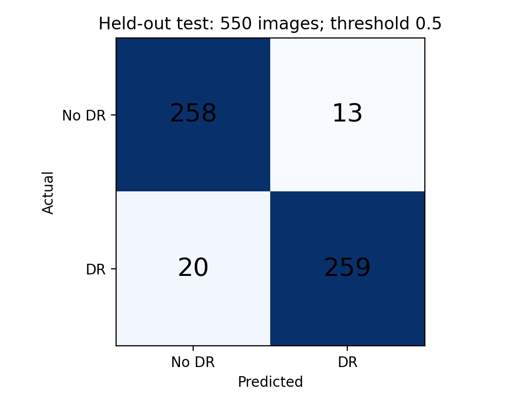

# Smart Retinal Camera AI

Research prototype prepared for PhD discussion. **Not clinically validated; not for diagnosis.** The project combines a frozen ResNet18 baseline, heuristic image-quality review flags, controlled blur experiments and Grad-CAM illustrations. No physical-camera deployment is claimed.



## Full code, training and Streamlit

The complete historical Colab source is now in [notebooks/full_research_code.ipynb](notebooks/full_research_code.ipynb). All 58 cells, including 40 code cells, are preserved; only outputs and metadata were removed from this shareable copy. It still contains Colab-specific paths and historical setup cells. It is an archive, not the new portable training entry point.

The downloaded notebook with its original saved outputs is kept locally at `private_archive/Smart_Retinal_Camera_AI_documented.ipynb`, alongside private provenance. This folder, checkpoint weights, manifests, datasets and new run outputs are excluded from Git. Use [LOCAL_WORKFLOW.md](LOCAL_WORKFLOW.md) for setup, new training runs, evaluation and the Streamlit interface.

```bash
python3.12 -m venv .venv
source .venv/bin/activate
python -m pip install -r requirements-local.txt
streamlit run app.py
```

The UI loads the preserved `models/resnet18_epoch1.pth` when available and discovers new `runs/*/best.pth` checkpoints. It supports image upload, a fixed-threshold experimental prediction, quality flags, positive-class Grad-CAM and JSON export. Historical metrics are labelled separately from the selected model's output. The complete APTOS image dataset is not included in this repository or the private backup.

## Evidence
APTOS 2019: 3,662 labelled photographs; binary grade 0 versus any DR. Image-level train/validation/test counts: 2,563/549/550. One completed epoch. Test accuracy 94.00%, sensitivity 92.83%, specificity 95.20%, AUC 0.9754, F1 0.9401. TN/FP/FN/TP = 258/13/20/259. See RESEARCH_REPORT.md for methods, validation-only blur results and limitations.

## Contents
- src/demo.py: standalone inference and review flags.
- requirements.txt and environment.json: observed dependency versions and runtime context.
- RESEARCH_REPORT.md: detailed findings and limitations.
- AUDIT_AND_REPRODUCIBILITY.md: historical issues and execution instructions.
- PHD_INTERVIEW_OUTLINE.md: timed five-minute outline.
- figures/: aggregate plots without retinal photographs.
- results/: aggregate performance tables.

## Run
Use an isolated Python environment compatible with environment.json. Install an appropriate official PyTorch/torchvision build for your CPU/CUDA platform, then install remaining requirements. The recorded requirements have not been tested as a clean portable installation.

    python -m pip install -r requirements.txt
    python src/demo.py --checkpoint /path/resnet18_epoch1.pth --image /path/image.png --output /path/new_demo.json

Obtain images through your own authorised APTOS/Kaggle access. The preserved trained checkpoint and split manifests are in the private Drive research release. This public scaffold does not distribute them. The output is an experimental class, an uncalibrated score and heuristic review flags. Review_required=false is not an assurance of image adequacy or absence of disease.

## Reproduction and limitations
Checkpoint inference is the route to the recorded model. Original head initialisation and shuffling were not seeded; retraining may differ. No clean-runtime full-notebook rerun, patient-level audit, external validation, calibration or clinical validation is claimed. Do not use the test set for threshold selection. See the execution guide before running historical notebook cells, which include incomplete setup diagnostics and checkpoint-writing training operations.

## Data and credentials
Do not commit Kaggle credentials, .env files, dataset images/archives, private prediction tables, split manifests or notebooks containing retinal panels. Private exports are separate from this GitHub scaffold. Dataset and derived-image redistribution permissions must be checked before sharing. No dataset licence or institutional endorsement is implied.

## Provenance
Evidence: the user's 01_dataset_exploration.ipynb in Colab, original cells 0–38, saved outputs and preserved checkpoint. Report values are rounded as displayed; aggregate exports retain available precision. Upstream method and dataset references are included in RESEARCH_REPORT.md.
